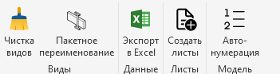

# MyTools — pyRevit Extension for Autodesk Revit 2026

A custom **pyRevit** extension designed to automate routine BIM workflows in **Autodesk Revit 2026 (.NET 8)**. The toolset adds a dedicated `MyTools` ribbon tab with 5 practical tools organized across 4 panels.



---

## Features

### Views
* **Batch View Renaming:** Rename multiple selected views at once by adding prefixes/suffixes or using find-and-replace.
* **Unused Views Cleanup:** Safely detect and delete unused views from the project while automatically protecting the active view.

### Sheets
* **Batch Sheet Generator:** Create multiple sheets in one click with custom title blocks, prefixes, sequential numbering, and built-in duplicate checks.

### Model
* **Spatial Auto-Numbering:** Automatically assign the `Mark` parameter to doors, windows, columns, and rooms on the active view, sorted spatially (left-to-right, top-to-bottom).

### Data
* **Schedule Export to Excel:** Batch export selected Revit schedules to clean **UTF-8 BOM CSV** files that open directly in Microsoft Excel with proper encoding.

---

## Requirements
* **Autodesk Revit 2026** (.NET 8)
* **[pyRevit](https://github.com/pyrevitlabs/pyRevit)** installed

---

## Installation
1. Download or clone this repository:
   ```bash
   git clone [https://github.com/ilyale228322/Revit-MyTools-pyRevit.git](https://github.com/ilyale228322/Revit-MyTools-pyRevit.git)
